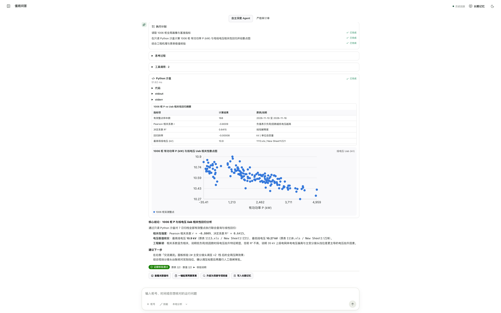
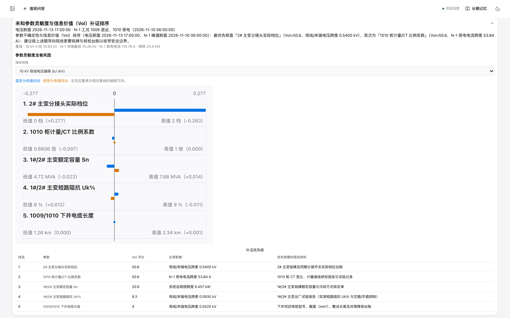
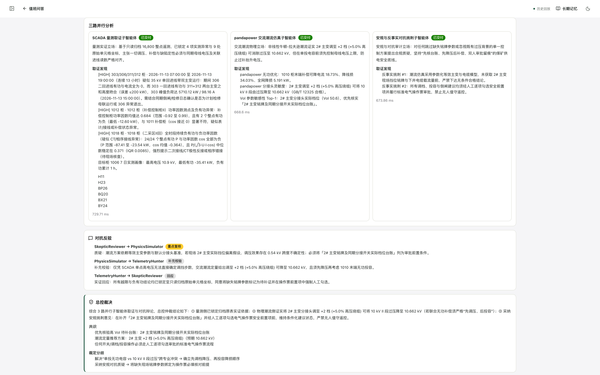

<div align="center">

# MineGrid-Agent

**炭鉱配電網の健全性監視・交流潮流最適化・反実仮想診断のための根拠拘束型マルチエージェントプラットフォーム**

[](https://github.com/wwe376549346-ux/MineGrid-Agent/actions/workflows/ci.yml)
[](https://www.python.org/)
[](https://fastapi.tiangolo.com/)
[](https://react.dev/)
[](https://www.pandapower.org/)
[](https://modelcontextprotocol.io/)
[](LICENSE)

<p>
  <a href="README.md">English</a> |
  <a href="README.zh-CN.md">简体中文</a> |
  <strong>日本語</strong> |
  <a href="README.ko.md">한국어</a>
</p>

</div>

---

**MineGrid-Agent** は、炭鉱 35/10 kV 配電網における継続的な健全性監視、根拠に基づく原因診断、非線形交流潮流計算、および運転員向け意思決定支援のために設計されたニューロシンボリック・マルチエージェントシステムです。

実際の時間別 SCADA 運転アーカイブ（地上 35 kV 変電所 25 盤・坑内 1535 中央変電所 15 盤・16,800 件の時系列データ・単線結線図・68 条の保安規程および国家規格）を不変の読み取り専用基準として、LLM 推論・決定論的電気検証・`pandapower` ニュートン＝ラフソン交流潮流ソルバ・Human-in-the-Loop（HITL）状態グラフを統合し、産業用電力分野における数値ハルシネーションを排除します。

---

## 主な機能

- **自律型エージェント & 読み取り専用 Python / pandapower サンドボックス**：AST 静的監査と分離サブプロセス内で相関回帰・負荷変動ランキング・カスタム潮流試算を動的に実行し、対話ストリーム内に純粋な SVG グラフ（散布図・折れ線・棒グラフ）と表を即時描画します。
- **文単位の根拠バインディング & Patch-Only Reflection**：すべての数値と時間差分を元 Excel セル座標またはツール計算証跡に厳密紐付けし、検証不一致の主張のみを局所修復します。
- **並列サブエージェント討論 & 168 時間離散最適化 / VoI 感度分析**：計測・潮流物理・保安規程の 3 並列サブエージェントによる対抗討論と調停を実施。7 日間（168 時間）のタップ・コンデンサ最適切替により過電圧違反を **35 時間 → 0 時間** へ解消し、系統損失を **109.02 kWh（+1.85%）** 削減します。
- **3 層永続運用メモリ（Auto-Memory）& 6 段階ディープ調査レポート**：カスタム電圧閾値・過去障害知見・運用 SOP を自動抽出・永続化し、印刷対応の HTML / Markdown 総合診断レポートをワンクリック出力します。
- **リアルタイム演習ストリーム・産業プロトコル（読み取り専用）& 操作票承認フロー**：CSV 増分取込および Modbus TCP / OPC-UA / MQTT 読み取り専用フレームの隔離検診に対応。電気開閉操作票ドラフトは必須安全チェック項目を運転員が全件確認するまで承認を厳格にブロック（HTTP 409）します。
- **プラグイン可能な Markdown スキル & 双方向 MCP エコシステム**：`skills/*.md` による運用手順のホットロードと 15 種の読み取り専用 MCP JSON-RPC 2.0 ツールを提供。

---

## ワークベンチ画面

<p align="center">
  <br/>
  <sub><b>自律型エージェント &amp; Generative UI：</b>動的計画ツリー、Python サンドボックス散布図、および根拠検証バッジ。</sub>
</p>

<p align="center">
  
  <br/>
  <sub><b>左：</b>pandapower パラメータ感度・VoI ランキング。 &nbsp;·&nbsp; <b>右：</b>計測・潮流・保安規程の 3 並列サブエージェント調停。</sub>
</p>

---

## CI 決定論テストと実機 LLM 評価の分離

- **決定論的オフライン CI ゲート（20 スイート）**：元表セル整合、数値ハルシネーション遮断（32 件の対抗ケース）、および等価回路前提下の 168 時間離散最適化（モデル過電圧 `35h → 0h`）を再現可能に検証します。
- **実機 `deepseek-v4-pro` エンドツーエンド評価（`N = 6`、詳細：[docs/LIVE_EVAL_REPORT.md](docs/LIVE_EVAL_REPORT.md)）**：
  - 厳格合格 **`5 / 6`（83.3%）**・部分合格 **`1 / 6`**（Q6）・失敗 **`0 / 6`**
  - Patch-Only Reflection **`3` 回**発動・応答遅延 **P50 `85.5 s` / P95 `157.07 s`**

---

## マルチ鉱山アダプタ（`MineProfile`）と既知の制約

- **宣言的アダプタ例**：[`profiles/dongpo_demo.json`](研究实施/老洼地数据接入_20261119/profiles/dongpo_demo.json)（35/6 kV 東坡デモ構成、`GET /api/profiles` で取得可能。実測第 2 鉱山データではなく設定テンプレートです）。
- **既知の制約**：実測アーカイブは単一鉱山の 7 日間（168 時間）に限定され、未確認の変圧器タップやケーブル許容電流は `model_assumptions` として明示開示されます。応答は数十秒を要するため、無人の即時保護制御ではなく運転員承認前提の支援ツールです。

---

## クイックスタート

### ルート `Makefile` コマンド

```bash
git clone git@github.com:wwe376549346-ux/MineGrid-Agent.git
cd MineGrid-Agent

make setup      # .venv-power 構築・SHA-256 検証・主要テスト実行
make up         # FastAPI + React 19 ワークベンチ起動 (http://127.0.0.1:8765/)
make test       # 20 種すべての決定論的検証ゲートを実行
make lint       # 静的構文・未定義参照チェック (ruff / py_compile)
make docker     # docker compose でコンテナを起動
```

*(PostgreSQL 16 + pgvector は任意構成であり、未設定時はローカル SQLite に自動フォールバックします。)*

### Docker ワンコマンド起動

```bash
git clone git@github.com:wwe376549346-ux/MineGrid-Agent.git
cd MineGrid-Agent
docker compose up --build
# ブラウザで http://127.0.0.1:8765/ を開く
```

### ローカル Python 環境での起動

```bash
git clone git@github.com:wwe376549346-ux/MineGrid-Agent.git
cd MineGrid-Agent
make setup && make up
```

> **セキュリティ原則**：原本 SQLite アーカイブは常に `mode=ro`（SHA-256 検証済み）で保護され、すべての操作提案は運転員による手動承認を必須とします。ライセンスは [MIT License](LICENSE) です。
