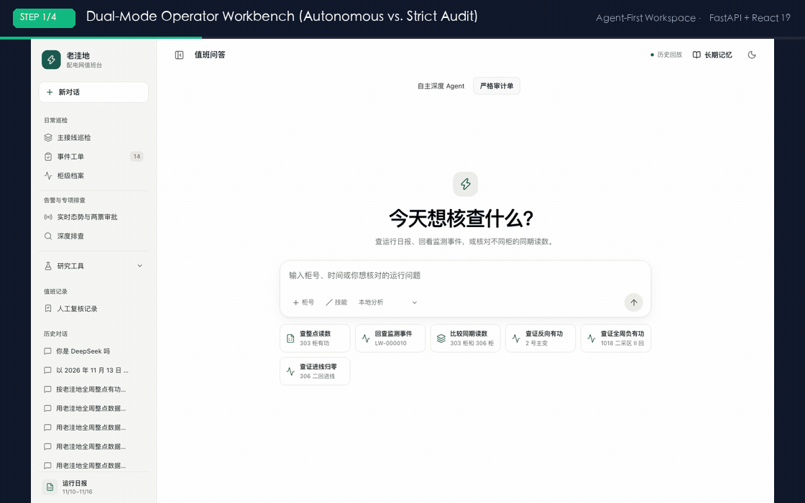
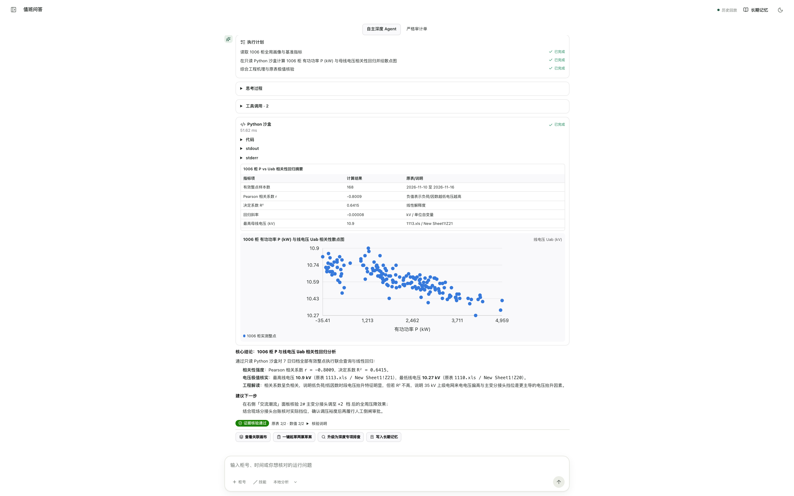
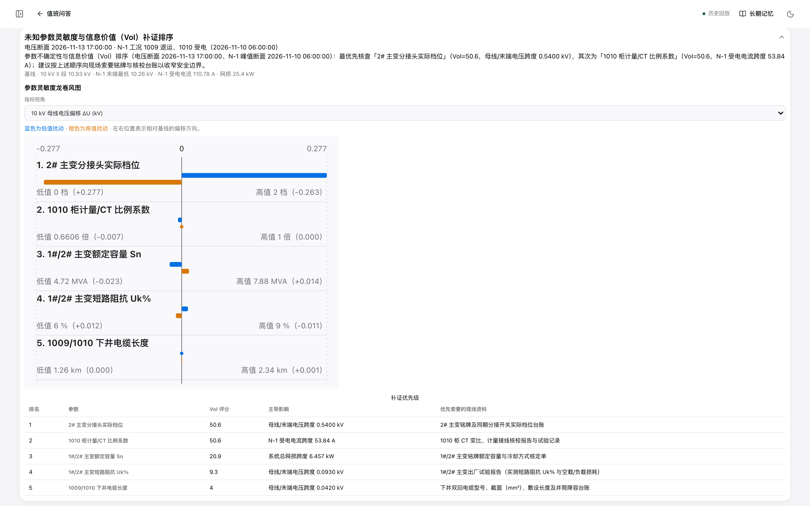
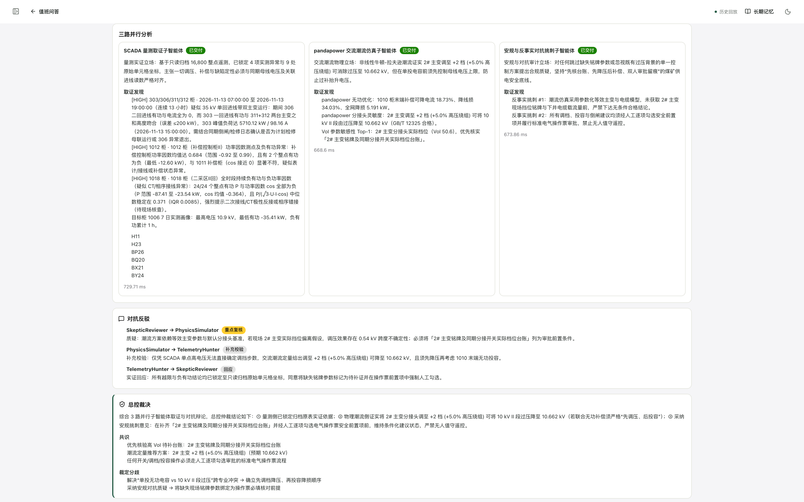

<div align="center">

# MineGrid-Agent

**탄광 배전망 건전성 모니터링·교류 조류 최적화·반사실 진단을 위한 근거 제약형 멀티 에이전트 플랫폼**

[](https://github.com/wwe376549346-ux/MineGrid-Agent/actions/workflows/ci.yml)
[](https://www.python.org/)
[](https://fastapi.tiangolo.com/)
[](https://react.dev/)
[](https://www.pandapower.org/)
[](https://modelcontextprotocol.io/)
[](LICENSE)

<p>
  <a href="README.md">English</a> |
  <a href="README.zh-CN.md">简体中文</a> |
  <a href="README.ja.md">日本語</a> |
  <strong>한국어</strong>
</p>

</div>

---

**MineGrid-Agent**는 탄광 35/10 kV 배전망의 상시 건전성 모니터링, 근거 기반 원인 진단, 비선형 교류 조류 최적화 및 운전원 의사결정 지원을 위해 설계된 뉴로-심볼릭 멀티 에이전트 시스템입니다.

실제 시간별 SCADA 운전 아카이브(지상 35 kV 변전소 25개 배전반, 지하 1535 중앙변전소 15개 배전반, 16,800건 시간별 계측 데이터, 단선결선도 및 68개 안전 규정·국가표준)를 읽기 전용 골든 기준으로 삼아 LLM 추론, 결정론적 전기 검증, `pandapower` 뉴턴-랩슨 교류 조류 해석기 및 HITL 상태 그래프를 결합하여 산업 전력 환경의 수치 환각을 원천 차단합니다.

---

## 핵심 기능

- **자율형 에이전트 & 읽기 전용 Python / pandapower 샌드박스**: AST 정적 보안 감사와 격리된 서브프로세스 환경에서 상관·회귀 분석, 부하 변동성 랭킹, 맞춤형 조류 시뮬레이션을 실시간 실행하고 대화창에 순수 SVG 차트(산점도·선·막대)와 표를 즉시 렌더링합니다.
- **문장 단위 근거 바인딩 & Patch-Only Reflection**: 모든 수치와 시간차 변화량을 원본 Excel 셀 좌표 또는 도구 계산 영수증에 엄격히 바인딩하고, 검증 실패 항목만 국소 수정합니다.
- **병렬 서브에이전트 토론 & 168시간 이산 최적화 / VoI 민감도 분석**: 계측·조류 물리·안전 규정 3개 병렬 서브에이전트가 교차 반박 및 중재를 수행합니다. 7일(168시간) 탭·커패시터 동적 계획 최적화로 과전압 위반을 **35시간 → 0시간**으로 제거하고 전력 손실을 **109.02 kWh (+1.85%)** 절감합니다.
- **3계층 영구 운영 메모리(Auto-Memory) & 6단계 심층 조사 리포트**: 사용자 지정 전압 기준선, 과거 장애 교훈, 운영 SOP를 자동 추출·저장하며 인쇄용 HTML / Markdown 종합 진단 보고서를 원클릭으로 내보냅니다.
- **실시간 텔레메트리 시뮬레이션·산업 프로토콜(읽기 전용) & 작업표 승인 워크플로우**: 증분 CSV 업로드와 Modbus TCP / OPC-UA / MQTT 읽기 전용 프레임의 격리 진단을 지원합니다. 전기 조작표 초안은 운전원이 모든 필수 안전 점검 항목을 직접 체크해야만 승인(미체크 시 HTTP 409 차단)됩니다.
- **플러그형 Markdown 스킬 & 양방향 MCP 생태계**: `skills/*.md` 운영 플레이북 핫로딩 및 15개 읽기 전용 MCP JSON-RPC 2.0 도구를 제공합니다.

---

## 워크벤치 실기 데모 및 스크린샷

<p align="center">
  <br/>
  <sub><b>v1.0.0 엔드투엔드 워크스루:</b> 이중 모드 코파일럿 홈 → Python 샌드박스 산점도 → <code>pandapower</code> VoI 토네이도 차트 → 3병렬 서브에이전트 토론 및 작업표.</sub>
</p>

<p align="center">
  <br/>
  <sub><b>자율 에이전트 &amp; Generative UI:</b> 동적 실행 계획, 읽기 전용 Python/SQL 산점도 및 사후 근거 검증 배지.</sub>
</p>

<p align="center">
  
  <br/>
  <sub><b>좌:</b> pandapower 파라미터 민감도 및 VoI 우선순위 차트. &nbsp;·&nbsp; <b>우:</b> 계측·조류·안전 규정 3병렬 서브에이전트 토론 중재.</sub>
</p>

---

## 결정론적 CI 검증 vs. 실제 LLM 라이브 평가

- **결정론적 오프라인 CI 게이트(20개 스위트)**: 원본 Excel 셀 매칭, 적대적 환각 차단(32건), 등가회로 가정 하의 168시간 탭·커패시터 최적화(모델 과전압 `35h → 0h`)를 오프라인에서 재현 검증합니다([v1.0.0 릴리스 노트](docs/RELEASE_v1.0.0.md)).
- **실제 `deepseek-v4-pro` 슬라이스 평가(`N = 6`, [docs/LIVE_EVAL_REPORT.md](docs/LIVE_EVAL_REPORT.md))**: 교차 변전소 고속 가드 및 임계값 정규식 개선 후 **`6 / 6` 통과**, Q3 응답 **`160.64 s → 0.07 s`**, 평균 지연 **`103.33 s → 57.76 s` (P50 `63.53 s`)** 단축.
- **실제 `deepseek-v4-pro` 4군 어블레이션(`18문항 × 4군 = 72회 실행`, [docs/LIVE_ABLATION_BENCHMARK.md](docs/LIVE_ABLATION_BENCHMARK.md))**:
  - **Ours**: 엄격 일치율 **`55.6%`** · 수치 환각률 **`5.6%`** · Citation F1 **`67.7%`** · 조류 계층 **`66.7%`** (vs. `w/o pandapower 38.9%`, `Vanilla 27.8% / 환각 31.6%`, `w/o Verifier 22.2%`; 클러스터 부트스트랩 기준 환각률 **`-26.0%`** 유의 감소).

---

## 멀티 광산 어댑터(`MineProfile`) 및 알려진 한계

- **선언적 어댑터 예시**: [`profiles/dongpo_demo.json`](研究实施/老洼地数据接入_20261119/profiles/dongpo_demo.json) (35/6 kV 동포 데모 프로파일, `GET /api/profiles` 조회 가능. 제2의 실측 광산 데이터셋이 아닌 온보딩 템플릿입니다).
- **알려진 한계**: 실측 아카이브는 단일 탄광 7일(168시간) 데이터에 국한되며, 미확인 변압기 탭 및 케이블 허용전류는 `model_assumptions`로 명시됩니다. 수십 초대 응답 특성상 무인 실시간 보호 제어용이 아니며 모든 작업은 운전원 승인 하에 권고안으로만 제공됩니다.

---

## 빠른 시작

### 루트 `Makefile` 단축 명령

```bash
git clone git@github.com:wwe376549346-ux/MineGrid-Agent.git
cd MineGrid-Agent

make setup      # .venv-power 구축, SHA-256 무결성 검증 및 핵심 게이트 실행
make up         # FastAPI + React 19 워크벤치 실행 (http://127.0.0.1:8765/)
make test       # 20개 결정론적 회귀 테스트 게이트 일괄 실행
make lint       # 정적 구문 및 미정의 심볼 검사 (ruff / py_compile)
make docker     # docker compose 컨테이너 빌드 및 실행
```

*(PostgreSQL 16 + pgvector는 선택적 런타임 저장소이며, 미설정 시 로컬 SQLite로 자동 폴백합니다.)*

### Docker 원클릭 실행

```bash
git clone git@github.com:wwe376549346-ux/MineGrid-Agent.git
cd MineGrid-Agent
docker compose up --build
# 브라우저에서 http://127.0.0.1:8765/ 접속
```

### 로컬 Python 가상환경 실행

```bash
git clone git@github.com:wwe376549346-ux/MineGrid-Agent.git
cd MineGrid-Agent
make setup && make up
```

> **보안 원칙**: 골든 SQLite 아카이브는 항상 `mode=ro`(SHA-256 무결성 검증)로 보호되며, 모든 제어 권고안은 운전원의 명시적 승인을 필수 조건으로 합니다. 라이선스는 [MIT License](LICENSE)를 따릅니다.
