# MineGrid-Agent：面向煤矿配电网运行健康监测与反事实诊断的证据约束型多智能体系统

**MineGrid-Agent** 是针对煤矿配电网日常运行监测数据量大、跨站档案不完备、通用大语言模型（LLM）易产生数值幻觉与错误因果归因等核心难题构建的垂直领域多智能体系统（Domain-Specific Multi-Agent System）。

本项目以**老洼地煤矿 35/10 kV 地面变电所（25 柜）与井下 1535 中央变电所（15 柜）**真实运行日报（16,800 条小时级遥测 + 2,100 条页尾统计）、监控一次系统图与《煤矿安全规程（2025）》《GB/T 50417-2017》《GB/T 12325》等 68 条规程国标为只读黄金基准，构建了**「四维确定性电气体检 + 句级神经符号证据核验 + 竞争假设多轮取证证伪 + 量测/潮流/安规多智能体协同仲裁 + 状态图人机协同补证（HITL）」**的完整研究与交互闭环。

---

## 一、 核心架构与学术创新点

```mermaid
flowchart LR
  subgraph Data["只读黄金数据与知识底座"]
    A1["7 份运行日报 (.xls)<br/>16,800 整点 + 2,100 页尾"]
    A2["2 张监控系统图 (.png)<br/>地面 25 柜 + 井下 15 柜"]
    A3["68 条煤矿安规与国标<br/>+ 8 张本矿动态证据卡"]
  end

  subgraph Core["MineGrid-Agent 核心推理与机理层"]
    B1["GSSC 上下文工程<br/>平稳段折叠 · 关键拐点 100% 保留"]
    B2["条件化混合 RAG<br/>BM25 + 领域语义 RRF + 跨站门控"]
    B3["竞争假设多步证伪循环<br/>H1 极性/轮询 vs H2 瓦斯反送 vs H3 环流"]
    B4["五角色多智能体协同与潮流复算<br/>量测 ⇄ pandapower 交流潮流 ⇄ 安规质疑"]
    B5["UnifiedDAGRuntime 状态图<br/>跨进程断点挂起与 HITL 零重复查库恢复"]
  end

  subgraph Guard["句级神经-符号双层核验与审计"]
    C1["证据槽位强绑定 [[1]] / [[delta]]<br/>原表单元格 + 工具计算回执对齐"]
    C2["独立语义审计 + Reflection 自修正<br/>拦截错柜/错时/假数值/越权控制"]
  end

  Data --> Core --> Guard
```



1. **句级神经-符号双层证据核验（Neuro-Symbolic Claim Grounding & Reflection）**：
   - 模型按照 `现象归纳 (observation) → 候选假设 (hypothesis) → 交叉检验 (cross_check) → 规程对标 (standard) → 待补证据 (gap) → 排查建议 (followup)` 撰写工程诊断推演；
   - 每个数值、柜号、时刻及同柜跨时差值（`[[delta]]`）强制绑定至原表单元格（如 `1112.xls / New Sheet1!H16`）或只读工具计算回执（`T1.1`），经本地确定性校验与独立语义审计双重把关，未通过项按断言索引退回模型触发 Reflection 重写（[laowadi/diagnostic_claims.py](研究实施/老洼地数据接入_20261119/laowadi/diagnostic_claims.py)、[laowadi/verifier.py](研究实施/老洼地数据接入_20261119/laowadi/verifier.py)）。
2. **竞争假设驱动的多步科学证伪（Hypothesis-Driven Falsification Loop）**：
   - 面对 `2# 主变（306/312/1006）` 全链负有功等复杂异常，智能体基于上一轮回执动态规划最具区分力的下一轮只读查询，利用同期 `1027 瓦斯发电站 I 回` 实测 `0 kW / 0 A` 原表证据在采样点证伪“下级反送电”假设，并严格区分“表计极性/SCADA 轮询偏移”与“母联环流”所需的现场待补证据（[laowadi/hypothesis.py](研究实施/老洼地数据接入_20261119/laowadi/hypothesis.py)）。
3. **数据驱动与物理潮流机理协同会诊（Data-Physics Multi-Agent Arbitration）**：
   - 集成 `pandapower` 牛顿-拉夫逊真实交流潮流求解器（[laowadi/powerflow.py](研究实施/老洼地数据接入_20261119/laowadi/powerflow.py)）；
   - 当 `1010` 柜低功率因数（`0.62`）末端无功补偿需求与 `10 kV II 段` 母线既有过压（`10.83–11.01 kV`）发生跨专业冲突时，安规专家对单投电容方案发起结构化合规质疑（`reactive-challenge`），驱动物理潮流专家同点复算“先将 2# 主变分接头调至 `+2 档` 降压至 `10.585 kV`、再投末端补偿提升功率因数至 `0.952`”的联合寻优方案（[laowadi/reactive_collaboration.py](研究实施/老洼地数据接入_20261119/laowadi/reactive_collaboration.py)、[laowadi/multi_agent.py](研究实施/老洼地数据接入_20261119/laowadi/multi_agent.py)）。
4. **GSSC 上下文工程、条件化混合 RAG 与统一动态 DAG 状态图（HITL）**：
   - **GSSC 上下文压缩**：长周期窗口查询净压缩 **45.2%** 字符，同时 100% 保留目标时刻、极值拐点与负有功单元格（[laowadi/context.py](研究实施/老洼地数据接入_20261119/laowadi/context.py)）；
   - **条件化混合 RAG**：Okapi BM25 + 煤矿电力概念语义向量 + RRF 融合，自动对无日报的井下 1535 中央变电所（`1101–1207` 柜）触发跨站适用性前置拦截（[laowadi/rag.py](研究实施/老洼地数据接入_20261119/laowadi/rag.py)）；
   - **统一动态 DAG 与 HITL 补证**：主诊断、多智能体会诊与补证审计图统一运行于 `UnifiedDAGRuntime`，支持缺铭牌/开关参数时原地挂起，跨进程补充参数或反向证词后 **0 重复查库** 增量恢复（[laowadi/dag_engine.py](研究实施/老洼地数据接入_20261119/laowadi/dag_engine.py)、[laowadi/supplement.py](研究实施/老洼地数据接入_20261119/laowadi/supplement.py)）。

---

## 二、 仓库目录结构

| 目录 / 文件 | 说明 |
| :--- | :--- |
| [AGENTS.md](AGENTS.md) | 项目研发铁律、数据边界与**课题组双人协同开发分工契约** |
| [项目知识库/老洼地智能体知识库.html](项目知识库/老洼地智能体知识库.html) | 交互式项目知识库（含 15 个构建阶段、现场资料原件预览、复验台与全部更新记录） |
| [项目知识库/资料/老洼地/](项目知识库/资料/老洼地/) | 老洼地 7 份原始运行日报（`1110.xls`–`1116.xls`）与 2 张一次系统图（100% 只读基准） |
| [研究实施/老洼地数据接入_20261119/laowadi/](研究实施/老洼地数据接入_20261119/laowadi/) | **MineGrid-Agent 核心 Python 包**（含 `diagnose.py`、`diagnostic_claims.py`、`hypothesis.py`、`verifier.py`、`multi_agent.py`、`reactive_collaboration.py`、`powerflow.py`、`dag_engine.py`、`rag.py`、`context.py`、`supplement.py`、`api.py` 等） |
| [研究实施/老洼地数据接入_20261119/workbench/](研究实施/老洼地数据接入_20261119/workbench/) | **React 19 + Meta Astryx 智能体交互工作台前端**（透明思考流、假设证伪卡、主接线动态潮流图、调压与无功协同复算台、对话内嵌 HITL 补证） |
| [研究实施/老洼地数据接入_20261119/thesis_eval/](研究实施/老洼地数据接入_20261119/thesis_eval/) | **48 题六维硕士论文评测基准与四项消融实验套件**（含 `cases.json`、`gold.json`、`probe.py`、`run.py`、`score.py` 及自动生成的 LaTeX 三线表报告 [本地实验结果.md](研究实施/老洼地数据接入_20261119/thesis_eval/results/本地实验结果.md)） |
| [研究实施/老洼地数据接入_20261119/scripts/setup_collab.sh](研究实施/老洼地数据接入_20261119/scripts/setup_collab.sh) | 课题组协同开发一键环境初始化、SHA-256 校验与合并前门禁自检脚本 |
| [公开数据与标准_20261113/](公开数据与标准_20261113/) / [文献精读/](文献精读/) | 《煤矿安全规程（2025）》《GB/T 50417-2017》原文核验记录与领域文献调研精读笔记 |

---

## 三、 快速开始与课题组协同开发指南

### 1. 克隆仓库并一键初始化环境（推荐）

新成员克隆仓库后，在项目根目录直接运行一键初始化脚本（自动配置 Python 3.12 虚拟环境 `.venv-power`、生成本地密钥配置模板、核验只读源库 SHA-256 并运行 5 套核心门禁测试）：

```bash
git clone git@github.com:wwe376549346-ux/MineGrid-Agent.git
cd MineGrid-Agent
bash 研究实施/老洼地数据接入_20261119/scripts/setup_collab.sh
```

> **配置真实 DeepSeek 密钥（仅保存在个人本机，已被 `.gitignore` 隔离）**：
> 编辑 `研究实施/大模型接入_20261115/.env.local`，填入 `COAL_API_BASE_URL`、`COAL_API_MODEL=deepseek-v4-pro` 与 `COAL_API_KEY`。

### 2. 启动 8765 智能体交互工作台

```bash
cd 研究实施/老洼地数据接入_20261119
../.venv-power/bin/python -B -m laowadi workbench --port 8765
```
启动后在浏览器访问 `http://127.0.0.1:8765/` 即可体验：
- **值班问答与透明推理流**：实时查看工具并发取证、GSSC 压缩率、逐轮竞争假设证伪（`HypothesisTrace`）、六段式断言与原表单元格点击下载；
- **主接线巡检（40 柜图模自动排版）**：168 小时动态潮流断面回放与 4 条 KCL 功率守恒方程实时校核；
- **交流潮流与多智体会诊**：`pandapower` 分接头灵敏度扫描、N-1 转供潮流、以及 `1010` 无功补偿 vs `10 kV II 段` 过压四工况协同复算对比表；
- **状态图补证与离线评测**：对话内或画布内在线提交设备铭牌参数触发 `v1 → v2` 局部复算（0 重复查库）。

### 3. 运行 48 题硕士论文评测基准与消融探针

```bash
cd 研究实施/老洼地数据接入_20261119
../.venv-power/bin/python -B -m thesis_eval.probe --output thesis_eval/results
```
运行后自动在 [`thesis_eval/results/本地实验结果.md`](研究实施/老洼地数据接入_20261119/thesis_eval/results/本地实验结果.md) 生成完整的六维组件评测表与可直接粘贴进硕士论文的 **LaTeX `booktabs` 三线表**。

---

## 四、 核心组件离线探针与消融实验结果摘要

| 测试维度 / 评测模块 | 样本量 | 完整方法 (`MineGrid-Agent`) | 消融对照 (`w/o Module`) | 核心机理增益 |
| :--- | :---: | :---: | :---: | :--- |
| **单点与多柜时空统计回执 (`S01–S08`, `M01–M08`)** | 16 题 | **100.0%** (16/16 数值与单元格对齐) | 需逐点拼接（易超上下文） | 中位耗时 `0.111 ms`，100% 附原表坐标 |
| **条件化混合检索跨站门控 (`C1535` 适用性拦截)** | 4 题 | **100.0%** (2/2 跨站缺日报前置拦截) | **0.0%** (0/2 拦截，纯 BM25) | 阻断对井下无日报分柜编造读数 |
| **GSSC 上下文工程 (`w/o GSSC`)** | 16 题 | 净压缩 **45.2%** (`179,672 → 98,424` 字符) | 0.0% 压缩 | 关键拐点与负有功证据保留率 **100.0% (28/28)** |
| **`pandapower` 交流潮流与调压/N-1 (`P01–P06`)** | 6 题 | **100.0%** (6/6 收敛且匹配金标准) | **0.0%** (0/6，缺非线性潮流) | 量化 2# 主变 `+2 档` 降压至 `10.662 kV` 及补偿降损 |
| **双层数值核验与幻觉阻断 (`S01–S08 × 4` 类反例)** | 32 组 | 幻觉拦截率 **100.0% (32/32)** + Reflection 修复 | 拦截率 **0.0% (0/32)** | 彻底阻断真坐标配假值、错单位、张冠李戴与假坐标 |
| **HITL 状态图两轮动态补证 (`H01–H08`)** | 8 题 | 状态迁移与负载率复算 **100.0% (8/8)** | 无状态图与反向证词否决 | 覆盖满足、越限、缺项与联络闭锁否决，复用 50%–75% 节点 |
