<div align="center">

# MineGrid-Agent

**Evidence-Grounded Multi-Agent Platform for Coal-Mine Distribution Network Health Monitoring, AC Power-Flow Optimization & Counterfactual Diagnostics**

[](https://github.com/wwe376549346-ux/MineGrid-Agent/actions/workflows/ci.yml)
[](https://www.python.org/)
[](https://fastapi.tiangolo.com/)
[](https://react.dev/)
[](https://www.pandapower.org/)
[](https://modelcontextprotocol.io/)

</div>

---

**MineGrid-Agent** is a domain-specific neuro-symbolic multi-agent system engineered for continuous health monitoring, evidence-grounded root-cause diagnosis, AC power-flow verification, and operator decision support in coal-mine 35/10 kV distribution networks.

Built on real hourly SCADA operational archives (35 kV surface substation with 25 switch cabinets, 1535 underground central substation with 15 switch cabinets, 16,800 hourly telemetry cells, 2,100 daily summary rows, primary one-line diagrams, and 68 safety regulations & national standards including *Coal Mine Safety Regulations 2025*, *GB/T 50417-2017*, and *GB/T 12325*), MineGrid-Agent eliminates numeric hallucinations and unverified causal leaps by tightly coupling LLM reasoning with deterministic electrical verification, nonlinear Newton-Raphson AC power flow, and human-in-the-loop (HITL) state graphs.

---

## System Architecture

```mermaid
flowchart LR
  subgraph Data["Read-Only Operational Archive & Domain Knowledge"]
    A1["Hourly SCADA Reports (.xls → SQLite)<br/>16,800 hourly cells · 2,100 footer stats"]
    A2["Primary One-Line Diagrams (.png)<br/>Surface 25 cabinets · Underground 15 cabinets"]
    A3["68 Safety Regulations & Standards<br/>MineProfile Metadata Schema (Pydantic v2)"]
  end

  subgraph Core["MineGrid-Agent Reasoning & Physics Engine"]
    B1["GSSC Context Engineering<br/>Steady-state folding · 100% inflection retention"]
    B2["Conditional Hybrid RAG<br/>BM25 + Domain Semantic RRF + Cross-Station Gate"]
    B3["Hypothesis-Driven Falsification Loop<br/>3 Scenarios · Cross-Turn Follow-Ups"]
    B4["Data-Physics Multi-Agent Arbitration<br/>Telemetry ⇄ pandapower AC Flow ⇄ Safety Audit"]
    B5["Discrete DP Optimizer & VoI Sensitivity<br/>24h/168h Tap-Cap Scheduling · Tornado VoI"]
    B6["UnifiedDAGRuntime (HITL)<br/>Cross-Process Suspend & Zero-Requery Resume"]
  end

  subgraph Guard["Neuro-Symbolic Verification & Interfaces"]
    C1["Claim-Level Grounding [[1]] / [[delta]]<br/>Cell Coordinates + Tool Receipts"]
    C2["Patch-Only Reflection<br/>Targeted Claim Repair · Zero Hallucination"]
    C3["React 19 Workbench · FastAPI · MCP Server<br/>Proactive Incident Tickets · Read-Only Sandbox"]
  end

  Data --> Core --> Guard
```



---

## Core Capabilities

### 1. Neuro-Symbolic Claim Grounding & Patch-Only Reflection
- Structures every diagnostic explanation into six verifiable slots: `observation` → `hypothesis` → `cross_check` → `standard` → `gap` → `followup`.
- Every numeric value, cabinet ID, timestamp, and intra-cabinet delta (`[[delta]]`) is bound to exact source spreadsheet coordinates (e.g., `1112.xls / New Sheet1!H16`) or read-only tool calculation receipts (`T1.1`).
- Deterministic local verification and independent semantic auditing intercept fabricated coordinates, swapped cabinets, unit mismatches, and unauthorized control recommendations. Failed claims trigger **Patch-Only Reflection**, repairing only failing claim indices while preserving verified reasoning ([laowadi/diagnostic_claims.py](研究实施/老洼地数据接入_20261119/laowadi/diagnostic_claims.py), [laowadi/verifier.py](研究实施/老洼地数据接入_20261119/laowadi/verifier.py)).

### 2. Multi-Scenario Hypothesis Falsification & Cross-Turn Follow-Ups
- Dynamically plans high-discriminative read-only tool queries across iterative verification rounds instead of single-shot guessing ([laowadi/hypothesis.py](研究实施/老洼地数据接入_20261119/laowadi/hypothesis.py)).
- Covers three core coal-mine operational fault classes with structured cross-turn follow-up tracking:
  - **Reverse Power Chain (`REVERSE_POWER`)**: Cross-checks 2# transformer chain (`306 / 312 / 1006`) negative active power against contemporaneous gas-generation incomer (`1027`, `0 kW / 0 A`) to falsify downstream backfeed at sampled hours.
  - **Feeder Metering Polarity (`FEEDER_POLARITY`)**: Separates CT/PT secondary polarity reversal from load shedding via multi-metric `P / Q / Ia / cosφ` consistency.
  - **Single-Incomer Zero-Load Regime (`ZERO_INCOMER`)**: Distinguishes scheduled switch-out maintenance from metering failure via companion incomer load transfer and bus-tie coupling.

### 3. Data-Physics Multi-Agent Arbitration (`pandapower` AC Power Flow)
- Integrates a calibrated `pandapower` Newton-Raphson AC power-flow solver driven by declarative `MineProfile` metadata (multi-mine ready with zero code changes; [laowadi/powerflow.py](研究实施/老洼地数据接入_20261119/laowadi/powerflow.py), [laowadi/mine_schema.py](研究实施/老洼地数据接入_20261119/laowadi/mine_schema.py)).
- Five specialized agent roles (`Measurement`, `PowerFlow`, `Safety`, `Topology`, `Arbitrator`) conduct structured evidence exchange and cross-professional challenges ([laowadi/multi_agent.py](研究实施/老洼地数据接入_20261119/laowadi/multi_agent.py), [laowadi/reactive_collaboration.py](研究实施/老洼地数据接入_20261119/laowadi/reactive_collaboration.py)):
  - **Reactive vs. Overvoltage Arbitration**: When low power factor on feeder `1010` (`cosφ = 0.62`) conflicts with existing overvoltage on `10 kV Bus II` (`10.83–11.01 kV`), the Safety Agent challenges capacitor-only compensation and drives the Physics Agent to jointly optimize **2# transformer tap `+2`** (`10.585 kV`) + **terminal compensation** (`cosφ = 0.952`).
  - **Counterfactual N-1 Transfer Re-Arbitration**: Evaluates `1009 → 1010` dual-basis N-1 load transfer across both measured and CT-ratio-corrected envelopes, automatically re-arbitrating under tighter thermal limits (e.g., `160 A` safe-limit counterfactual).

### 4. Multi-Horizon Optimal Switching, Pareto Frontier & Parameter VoI Sensitivity
- **24-Hour & 168-Hour Discrete Dynamic Programming**: Optimizes discrete OLTC tap positions and capacitor banks under strict daily switching budgets and GB/T 12325 voltage bounds. On the full 7-day (168 h) archive, voltage violations drop from **35 h → 0 h** while cutting active losses by **109.02 kWh (+1.85%)**.
- **6-Budget Switching-Cost vs. Loss-Saving Pareto Frontier**: Quantifies exact engineering trade-offs between switching wear and energy savings (`0/0` through `2/6` tap/cap operations per day).
- **Parameter Uncertainty Sensitivity & Value-of-Information (VoI)**: Perturbs unverified equivalent parameters (transformer tap position, CT metering ratio, transformer rated capacity, short-circuit impedance `uk%`, underground cable length) via AC power flow to rank which missing field nameplate/log document yields the highest diagnostic information gain.

### 5. Unified Dynamic DAG Runtime (HITL) & Proactive Monitoring
- **UnifiedDAGRuntime** ([laowadi/dag_engine.py](研究实施/老洼地数据接入_20261119/laowadi/dag_engine.py), [laowadi/supplement.py](研究实施/老洼地数据接入_20261119/laowadi/supplement.py)): Suspends execution deterministically when nameplate ratings or switch logs are missing, persists checkpoints across processes, and resumes with **0 redundant archive queries** once field evidence is supplied—preserving conflict states whenever field testimony contradicts archived telemetry.
- **Proactive Incident Watcher & Pre-Diagnosis** ([laowadi/proactive.py](研究实施/老洼地数据接入_20261119/laowadi/proactive.py)): Continuously scans operational windows, generates structured incident tickets with automatic root-cause pre-diagnosis, and supports one-click escalation into interactive chat sessions.
- **Standard Read-Only MCP Server** ([laowadi/mcp_server.py](研究实施/老洼地数据接入_20261119/laowadi/mcp_server.py)): Exposes 15 strictly read-only JSON-RPC 2.0 tools (`readOnlyHint: true`) for seamless integration with external AI clients and industrial copilots.

---

## Engineering Evaluation & Ablation Metrics

All metrics below are deterministically reproduced against the read-only operational archive via the automated verification suite:

| Evaluation Dimension | Sample Size | Full System (`MineGrid-Agent`) | Baseline / Ablation (`w/o Module`) | Measured Engineering Gain |
| :--- | :---: | :---: | :---: | :--- |
| **Point & Multi-Cabinet Telemetry Receipts (`S01–S08`, `M01–M08`)** | 16 cases | **100.0%** (16/16 value & cell match) | Manual stitching / context overflow | Median latency `0.111 ms`, 100% source cell binding |
| **Conditional Hybrid RAG Cross-Station Gate (`C1535`)** | 4 cases | **100.0%** (2/2 missing-archive gate) | **0.0%** (pure BM25) | Prevents fabricating readings for unarchived underground cabinets |
| **GSSC Context Engineering (`w/o GSSC`)** | 16 cases | **45.2%** net compression (`179.7k → 98.4k` chars) | 0.0% compression | **100.0% (28/28)** retention of extrema & reverse-power anomalies |
| **`pandapower` AC Power Flow, Tap & N-1 (`P01–P06`)** | 6 cases | **100.0%** (6/6 NR convergence & gold match) | **0.0%** (no nonlinear solver) | Calibrated residual `≤ 0.05 kV`; exact tap `+2` voltage & loss quantification |
| **Neuro-Symbolic Verification & Hallucination Blocking** | 32 adversarial | **100.0% (32/32)** blocked + Reflection repair | **0.0%** (unverified generation) | Blocks fake values on real cells, swapped cabinets, unit & coordinate errors |
| **HITL State-Graph Dynamic Supplement (`H01–H08`)** | 8 cases | **100.0% (8/8)** state transitions & recalculation | No checkpoint / conflict tracking | Reuses 50%–75% unaffected nodes; preserves field-vs-archive conflicts |
| **168-Hour Discrete Tap-Cap DP Optimization** | 7 days (168 h) | **0 / 168 h** violations (`-109.02 kWh` loss) | **35 / 168 h** violations (baseline) | Eliminates 100% overvoltage hours while saving `1.85%` network loss |

---

## Quick Start

### Prerequisites
- **Python 3.11+** (3.12 recommended)
- **Node.js 20+** (only required when rebuilding the React 19 frontend)
- **PostgreSQL 16 + pgvector** *(optional; automatically falls back to local SQLite for runtime state)*

### 1. Clone & Bootstrap Environment

```bash
git clone git@github.com:wwe376549346-ux/MineGrid-Agent.git
cd MineGrid-Agent
bash 研究实施/老洼地数据接入_20261119/scripts/setup_collab.sh
```

The bootstrap script creates the virtual environment (`.venv-power`), installs `laowadi-power-agent` in editable mode, verifies the SHA-256 checksums of the read-only archives, and runs the core pre-merge test gates.

### 2. Configure LLM Provider *(Optional — Local Deterministic Mode Works Offline)*

MineGrid-Agent works completely offline in deterministic local mode. To enable LLM-assisted tool planning and synthesis, configure your OpenAI-compatible endpoint in `研究实施/大模型接入_20261115/.env.local` (ignored by Git):

```dotenv
COAL_API_BASE_URL=https://api.deepseek.com/v1
COAL_API_MODEL=deepseek-v4-pro
COAL_API_KEY=your-api-key-here
```

### 3. Launch the Interactive Operator Workbench

```bash
cd 研究实施/老洼地数据接入_20261119
../.venv-power/bin/python -B -m laowadi workbench --port 8765 --workers 1 --external-workers 1
```

Open **`http://127.0.0.1:8765/`** in your browser:
- **Operator Q&A & Live Reasoning Stream (SSE)**: Watch parallel tool calls, GSSC compression metrics, multi-round hypothesis falsification cards, claim verification badges, and clickable source Excel cell previews.
- **Primary One-Line Topology Inspector (40 Cabinets)**: Replay 168-hour telemetry snapshots and live KCL power-balance equations across surface & underground buses.
- **AC Power-Flow, Optimal Scheduling & VoI Lab**: Inspect Newton-Raphson calibration, tap sweeps, N-1 counterfactual transfers, 24h/168h DP schedules, Pareto curves, and parameter sensitivity tornado charts.
- **HITL Supplement & Proactive Incident Center**: Submit field nameplate/switch-log packets to trigger `v1 → v2` selective recalculation, or triage auto-diagnosed incident tickets.

### 4. CLI, REST API & Read-Only MCP Server

**CLI Quick Commands**:
```bash
cd 研究实施/老洼地数据接入_20261119

# Inspect read-only archive summary
../.venv-power/bin/python -m laowadi status

# Run grounded root-cause diagnosis
../.venv-power/bin/python -m laowadi diagnose "请排查 2026年11月12日 1006 柜负有功原因并核验 1027 瓦斯发电站状态"

# Run pandapower AC power-flow tap sensitivity
../.venv-power/bin/python -m laowadi powerflow --scenario tap_sensitivity --at "2026-11-13 17:00:00"

# Start stdio JSON-RPC 2.0 Read-Only MCP Server
../.venv-power/bin/python -m laowadi mcp
```

**FastAPI OpenAPI Documentation**:
- Interactive Swagger UI: `http://127.0.0.1:8765/docs`
- OpenAPI 3.1 Schema (60+ typed endpoints): `http://127.0.0.1:8765/openapi.json`
- Liveness & Readiness Probes: `GET /healthz`, `GET /readyz`

**MCP Client Configuration Example**:
```json
{
  "mcpServers": {
    "minegrid-agent": {
      "command": "/path/to/.venv-power/bin/python",
      "args": ["-m", "laowadi", "mcp"],
      "cwd": "/path/to/MineGrid-Agent/研究实施/老洼地数据接入_20261119"
    }
  }
}
```

---

## Repository Structure

| Path | Description |
| :--- | :--- |
| [研究实施/老洼地数据接入_20261119/laowadi/](研究实施/老洼地数据接入_20261119/laowadi/) | Core Python package (`diagnose.py`, `diagnostic_claims.py`, `hypothesis.py`, `verifier.py`, `powerflow.py`, `multi_agent.py`, `reactive_collaboration.py`, `dag_engine.py`, `supplement.py`, `proactive.py`, `rag.py`, `context.py`, `mcp_server.py`, `api.py`) |
| [研究实施/老洼地数据接入_20261119/workbench/](研究实施/老洼地数据接入_20261119/workbench/) | React 19 + Meta Astryx + Vite frontend workbench (topology canvas, SSE chat stream, AC power-flow charts, sensitivity tornado chart, incident ticket panel, HITL supplement UI) |
| [研究实施/老洼地数据接入_20261119/profiles/](研究实施/老洼地数据接入_20261119/profiles/) | Declarative YAML/JSON `MineProfile` topology & electrical parameter schemas |
| [研究实施/老洼地数据接入_20261119/local/](研究实施/老洼地数据接入_20261119/local/) | Read-only SQLite telemetry & event golden archives (`laowadi.sqlite3`, `laowadi_events.sqlite3`) |
| [研究实施/老洼地数据接入_20261119/scripts/setup_collab.sh](研究实施/老洼地数据接入_20261119/scripts/setup_collab.sh) | One-command environment setup, SHA-256 verification & pre-merge test gate script |
| [研究实施/老洼地数据接入_20261119/thesis_eval/](研究实施/老洼地数据接入_20261119/thesis_eval/) | 48-case six-dimensional offline benchmark & 4-way ablation suite (`cases.json`, `gold.json`, `probe.py`, `run.py`, `score.py`) |
| [项目知识库/资料/老洼地/](项目知识库/资料/老洼地/) | Original 7 operational `.xls` reports and 2 primary one-line `.png` diagrams (strictly read-only) |
| [.github/workflows/ci.yml](.github/workflows/ci.yml) | Automated GitHub Actions CI pipeline (archive integrity, Python test matrix, React build) |

---

## Security & Read-Only Integrity Boundaries

- **Immutable Source Archives**: Both `laowadi.sqlite3` and `laowadi_events.sqlite3` are opened in read-only mode (`mode=ro`) and checksum-verified (`SHA-256`) in every test gate and CI run.
- **No Unattended Control Execution**: All 15 diagnostic & MCP tools carry `readOnlyHint: true`. Recommended switching actions (tap changes, capacitor switching, load transfer) are strictly advisory and require operator review and sign-off.
- **Origin & Input Hardening**: FastAPI endpoints enforce strict Pydantic v2 schema validation, CSRF Origin allowlisting, and isolated local credential storage (`.env.local` excluded via `.gitignore`).

---

## Testing & Verification

Run the automated verification suite from `研究实施/老洼地数据接入_20261119/`:

```bash
# Core correctness, claim grounding & reflection
../.venv-power/bin/python -B verify_p0_correctness.py
../.venv-power/bin/python -B verify_diagnostic_claims.py
../.venv-power/bin/python -B verify_diagnose.py

# Multi-agent arbitration, AC power flow, 24h/168h DP & VoI sensitivity
../.venv-power/bin/python -B verify_multi_agent_and_governance.py
../.venv-power/bin/python -B verify_enterprise_and_powerflow.py

# Unified DAG HITL supplement, MCP parity & multi-mine generalization
../.venv-power/bin/python -B verify_unified_dag.py
../.venv-power/bin/python -B verify_supplement_and_mcp.py
../.venv-power/bin/python -B verify_multimine_generalization.py

# Proactive incident delivery, workbench API & 48-case offline benchmark
../.venv-power/bin/python -B verify_proactive_delivery.py
../.venv-power/bin/python -B verify_workbench.py
../.venv-power/bin/python -B -m thesis_eval.probe --output thesis_eval/results
```

To rebuild the React 19 workbench bundle:

```bash
cd 研究实施/老洼地数据接入_20261119/workbench
npm ci
npm run build
```
