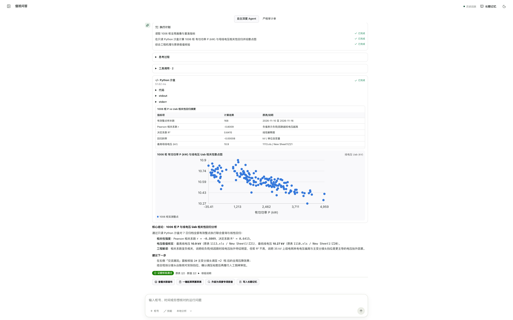
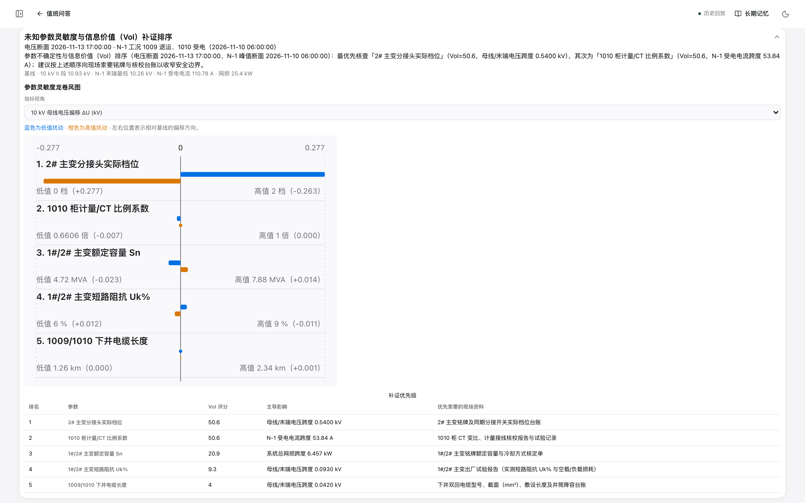
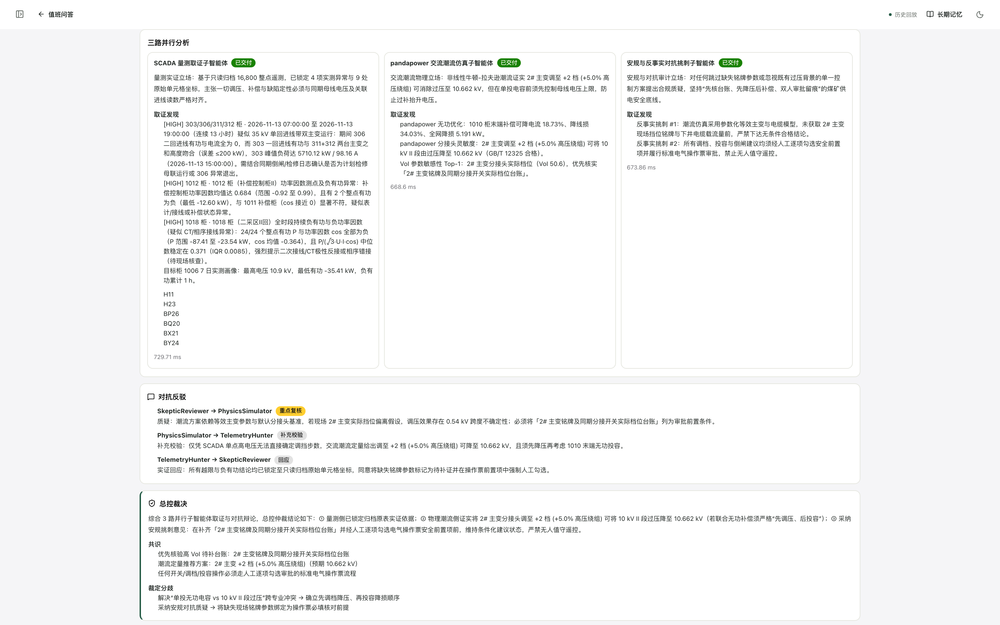

<div align="center">

# MineGrid-Agent

**面向煤矿配电网运行健康监测、交流潮流优化与反事实诊断的证据约束型多智能体平台**

[](https://github.com/wwe376549346-ux/MineGrid-Agent/actions/workflows/ci.yml)
[](https://www.python.org/)
[](https://fastapi.tiangolo.com/)
[](https://react.dev/)
[](https://www.pandapower.org/)
[](https://modelcontextprotocol.io/)
[](LICENSE)

<p>
  <a href="README.md">English</a> |
  <strong>简体中文</strong> |
  <a href="README.ja.md">日本語</a> |
  <a href="README.ko.md">한국어</a>
</p>

</div>

---

**MineGrid-Agent** 是一个面向煤矿 35/10 kV 配电网持续健康监测、证据约束型根因诊断、交流潮流优化与值班决策支持的垂直领域神经-符号多智能体系统。

系统基于真实小时级 SCADA 运行归档（地面 35 kV 变电所 25 柜、井下 1535 中央变电所 15 柜、16,800 条小时遥测、2,100 条页尾统计、一次系统接线图以及 68 条《煤矿安全规程（2025）》《GB/T 50417-2017》《GB/T 12325》条款），将大语言模型推理与确定性电气核验、非线性牛顿-拉夫逊交流潮流求解器（`pandapower`）及人机协同状态图深度融合，有效抑制工业电力场景中的数值幻觉与无依据归因。

---

## 系统架构

```mermaid
flowchart LR
  subgraph Data["只读运行归档与领域知识底座"]
    A1["小时级 SCADA 运行日报 (.xls → SQLite)<br/>16,800 整点 · 2,100 页尾统计"]
    A2["一次主接线图 (.png)<br/>地面 25 柜 · 井下 15 柜"]
    A3["68 条煤矿安规与国标<br/>MineProfile 声明式矿井图模"]
  end

  subgraph Core["MineGrid-Agent 自主推理与物理计算层"]
    B1["自主深度 Agent + 只读 Python/pandapower 沙盒<br/>动态计划树 · 报错自修 · 内嵌 SVG 图表"]
    B2["并行子智能体辩论与多智体仲裁<br/>量测取证 ⇄ 交流潮流仿真 ⇄ 安规对抗挑刺"]
    B3["168h 离散 DP 调压投容 & VoI 灵敏度<br/>6 组帕累托前沿 · 5 参数补证排序"]
    B4["三层持久化运营记忆 & 6 阶段深度专项排查<br/>Auto-Memory 提炼 · 可打印 HTML/MD 报告"]
    B5["可插拔 Markdown 技能 & 只读工业协议接入<br/>Modbus TCP / OPC-UA / MQTT · MCP 双向生态"]
  end

  subgraph Guard["双层核验、审批治理与交互工作台"]
    C1["句级证据槽位绑定 + Patch-Only Reflection<br/>原表单元格坐标与数值双重校核"]
    C2["标准化电气两票人工逐项审批流<br/>未勾全安全前置强制拦截 (HTTP 409)"]
    C3["React 19 工作台 · FastAPI (OpenAPI 3.1) · Docker"]
  end

  Data --> Core --> Guard
```



---

## 核心能力

1. **自主深度 Agent 与受控只读 Python 分析沙盒**：支持「自主深度 Agent」与「严格审计单」双模式一键切换；在 AST 静态审计、脱敏子进程与只读 SQLite 沙盒中现场编写 Python/SQL/NumPy/SciPy/`pandapower` 脚本，完成相关性回归、负荷曲线波动排行、自定义潮流试算并直接在对话气泡渲染纯 SVG 图表与表格。
2. **句级神经-符号证据核验与 Patch-Only Reflection**：每个数值与跨时差值强制绑定至原表单元格或只读工具回执，在 32 项对立样本门禁中拦截虚假数值与错位坐标，并在真实大模型调用中触发局部增量修补。
3. **并行子智能体辩论与交流潮流联合寻优**：并行派生量测取证、潮流仿真与安规对抗挑刺子智能体开展结构化质疑与仲裁；168 小时离散动态规划将全周过压整点由 **35 h 清零至 0 h**，累计节电 **109.02 kWh（+1.85%）**，并按信息价值（VoI）量化现场待补台账优先级。
4. **三层持久化长期记忆（含 Auto-Memory）与 6 阶段深度专项排查**：持久化存储矿井定制考核红线、历史排障案例与运维 SOP，对话中自动识别新规则一键入库；6 阶段长程排查一键导出可打印 HTML / Markdown 专项报告。
5. **实时态势演练、只读工业协议接入与标准化两票审批**：支持增量 CSV 上传与 Modbus TCP / OPC-UA / MQTT 只读遥测帧接入隔离沙盒体检；越限时即时预诊断并起草《电气倒闸操作票草案》《二次缺陷消缺单》《现场台账补录单》，全部必核安全项经人工勾选后方允许签发，严禁无人值守遥控开关。
6. **可插拔 Markdown 技能库与双向 MCP 生态**：支持热加载 `skills/*.md` 矿井值班技能，对外暴露 15 个严格只读 MCP JSON-RPC 2.0 工具，同时支持注册探测外部只读 MCP Server。

---

## 实机工作台截图

<p align="center">
  <br/>
  <sub><b>自主深度 Agent 与 Generative UI：</b>动态计划树、只读 Python/SQL 相关性散点图与后置原表核验徽章。</sub>
</p>

<p align="center">
  
  <br/>
  <sub><b>左：</b>pandapower 未知参数敏感性龙卷风图与 VoI 补证排序。 &nbsp;·&nbsp; <b>右：</b>量测 vs. 潮流 vs. 安规三路并行辩论仲裁面板。</sub>
</p>

---

## 确定性 CI 回归与真实大模型在线评测

> **评测口径说明**：我们将 **20 套离线确定性工程门禁**（SQLite 原表核验、`pandapower` 物理求解、安全围栏、API 契约）与 **真实大模型在线端到端实测** 严格区分，绝不将确定性单元测试宣传为开放式大模型 100% 准确率。

- **确定性离线 CI 门禁（20 套）**：详见 [GitHub Actions CI](.github/workflows/ci.yml)，验证 `16/16` 原表单元格绑定、`32/32` 虚假值/错柜拦截与 Patch-Only Reflection、`6/6` 牛顿-拉夫逊交流潮流收敛及 `168 h` 等值模型下过压整点 `35 → 0`（节电 `+109.02 kWh`）。
- **真实 `deepseek-v4-pro` 在线评测切片（`N = 6`，详情见 [docs/LIVE_EVAL_REPORT.md](docs/LIVE_EVAL_REPORT.md)）**：
  - **严格通过**：**`5 / 6`（83.3%）**（单进线归零、反向有功证伪、C1535 跨站拒答、1006 沙盒 Pearson `-0.801` 回归、`pandapower` `+2 档` 调压）；
  - **部分通过**：**`1 / 6`**（Q6 准确查出 `10.9 kV` 峰值并提炼 1 条语义规则，但口语化句式未命中结构化 `10.65 kV` 阈值正则）；**失败/超时**：**`0 / 6`**；
  - **真实 Reflection 触发与延迟**：累计触发 **`3` 次**局部自修拦截（Q1 ×2、Q3 ×1）；整问端到端耗时 **均值 `103.33 s` · P50 `85.5 s` · P95 `157.07 s`**。

---

## 多矿快速适配示例（`MineProfile`）

全系统告警阈值、母线平衡方程、接线图排版与 `pandapower` 潮流模型均由 `MineProfile` 声明式驱动（只读接口 `GET /api/profiles`）：
- **真实归档基准**：`laowadi`（老洼地 35/10 kV，基于 7 天实测运行日报）。
- **示例接入模板**：[`profiles/dongpo_demo.json`](研究实施/老洼地数据接入_20261119/profiles/dongpo_demo.json)（东坡 35/6 kV 声明式适配样例，用于多矿拓扑与 API 校核演示，非第二座实测矿井数据集）。

---

## 适用边界与已知局限

1. **单矿 7 日时间窗**：当前真实量测归档为单座煤矿连续 7 日（2026-11-10 至 2026-11-16 共 168 整点）；跨季节长期鲁棒性与新矿接入仍需现场持续数据验证。
2. **等值电路参数假设**：当日报缺失主变实际挡位、阻抗百分比或下井电缆长期允许载流量时，交流潮流显式采用并披露 `model_assumptions`，并通过 VoI 敏感性排序提示优先核实。
3. **非无人值守实时保护产品**：含大模型规划与潮流仿真的多步交互时延在数十秒级（P50 `85.5 s`），仅面向值班辅助决策与复盘研判，严禁替代微机保护或未经人工两票审批直接遥控开关。

---

## 快速开始

### 根目录 `Makefile` 快捷命令

```bash
git clone git@github.com:wwe376549346-ux/MineGrid-Agent.git
cd MineGrid-Agent

make setup      # 创建 .venv-power、校验归档 SHA-256 并跑核心门禁
make up         # 启动 FastAPI + React 19 工作台 (http://127.0.0.1:8765/)
make test       # 运行全套 20 个确定性验证门禁
make lint       # 运行静态语法与未定义变量检查 (ruff / py_compile)
make docker     # Docker Compose 一键构建启动
```

*注：PostgreSQL 16 + pgvector 为可选运行态存储后端，未部署时零配置自动回退本地 SQLite。*

### 方式一：Docker 一键启动（推荐快速体验）

```bash
git clone git@github.com:wwe376549346-ux/MineGrid-Agent.git
cd MineGrid-Agent
docker compose up --build
# 浏览器访问 http://127.0.0.1:8765/
```

### 方式二：本地 Python 虚拟环境启动

```bash
git clone git@github.com:wwe376549346-ux/MineGrid-Agent.git
cd MineGrid-Agent
make setup && make up
```

可选配置 OpenAI 兼容大模型端点（本地离线模式无需 API Key 即可完整运行）：编辑 `研究实施/大模型接入_20261115/.env.local` 填入 `COAL_API_BASE_URL`、`COAL_API_MODEL` 与 `COAL_API_KEY`。

---

## 安全与只读数据边界

- **黄金归档库只读不可变**：核心 SQLite 归档以 `mode=ro` 打开并在每次门禁与 CI 中校验 `SHA-256`。
- **零无人值守遥控执行**：所有 15 项诊断/MCP 工具与工业协议适配器均严格只读，两票草案必须经人工逐项勾选审批。
- **MIT 开源许可**：详见 [LICENSE](LICENSE)。
